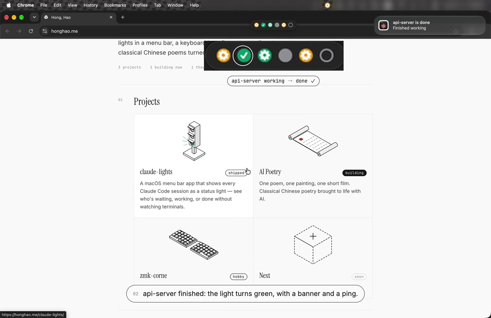

# Claude Lights

**Website:** https://honghao.me/claude-lights/ (English / 中文, with a demo video)

A macOS menu bar app that shows every local Claude Code session as a status
dot. Each state is encoded twice — a colorblind-safe color **and** a glyph —
so it reads clearly regardless of color vision:

| Dot | State |
|-----|-------|
| **!** vermillion | Waiting for you (input / permission approval) |
| ⚙ amber (spinning) | Running (working) |
| **✓** bluish-green | Done — finished, not yet looked at |
| ⚙ bluish-green (static) | Answered — a background task is still running |
| filled gray | Idle — already seen |
| hollow gray | Just started, nothing yet |

Includes an always-on-top floating light bar, one-click jump to the
session's tmux window or [herdr](https://github.com/herdrdev/herdr) pane
(iTerm2, Apple Terminal, or VS Code), a notification with sound when a
session needs you or finishes, a details menu with one-click **Close** for
any session, and Save / Restore of your sessions across reboots.


[](https://honghao.me/claude-lights/)

(Click for the 45 s demo on the website. All sessions in it are made up for
the recording.)

## Requirements

- macOS 13+
- Claude Code ≥ 2.1.207 — reads `~/.claude/sessions/*.json`. This is the
  first version whose registry reports the `waiting` status that drives the
  red "needs you" light; on older versions a session awaiting your input
  never turns red. The app flags any session running an older version in
  its menu.
- tmux or herdr (optional — needed to jump to the exact window/pane; a
  Claude session run directly in a terminal tab jumps without either). For
  herdr, install its Claude integration (`herdr integration install claude`)
  so herdr reports which pane runs which session. Only the default herdr
  session is supported.
- iCloud Drive (optional — needed for Save / Restore)

## Install

### Option 1 — Build from source (recommended)

```bash
git clone https://github.com/agate/claude-lights.git
cd claude-lights
scripts/bundle.sh
open build/ClaudeLights.app
```

Building locally avoids macOS quarantine entirely and lets you audit what
you run. Requires the Xcode command line tools (`xcode-select --install`).

### Option 2 — Download a release

Grab `ClaudeLights.zip` from the [latest release](https://github.com/agate/claude-lights/releases),
unzip, and move `ClaudeLights.app` wherever you like (e.g. `/Applications`).

The app is not notarized (no Apple Developer certificate), so on first
launch macOS will refuse to open it. Either:

- open **System Settings → Privacy & Security** and click **Open Anyway**
  after the first failed attempt, or
- clear the quarantine flag yourself:

  ```bash
  xattr -d com.apple.quarantine /path/to/ClaudeLights.app
  ```

The binary is universal (Apple Silicon + Intel).

Once installed, the app keeps itself up to date: it checks GitHub Releases
on launch and daily, notifies you when a new version is out, and updates in
one click (**Check for Updates…** in the menu works any time). In-app
updates carry no quarantine flag, so the Gatekeeper step above is only ever
needed once.

### First launch

Grant the notification permission when asked; the first click-to-jump (or
Close of a terminal tab) also asks once for permission to control your
terminal (iTerm2, Apple Terminal, or VS Code). Save / Restore need access to iCloud Drive; macOS may ask the
first time.

## Usage

- **Menu bar dot** shows the aggregate state — red if any session needs you,
  else the spinning gear if any is running, else green/gray. Click it for a
  per-session list: each row shows the session's title and how long ago it
  changed, over its state, what it's waiting for (or its project) and ⚙N
  for the commands it's running. Click a row to jump; hold **⌥ Option** and
  a row opens that session's details submenu (see below).
- **Floating bar**: one dot per session in a fixed order (by launch time), so
  each session keeps its place — only its color changes as it works, waits,
  or finishes. Hover for a one-line summary, click to jump, right-click for
  the details menu, drag to reposition.
  - Drag it near the **top-right corner** to magnetically pin it there; it
    then stays flush with that corner as sessions come and go. Drag it away
    to unpin.
  - It **follows the screen you're working on** (instantly when you switch
    apps) and moves to a remaining screen if you unplug a monitor.
- **Jump** switches tmux to the session's window/pane and focuses the exact
  iTerm2 / Apple Terminal tab, or the VS Code window for its folder. For a
  session inside **herdr**, it focuses the session's herdr pane and the tab
  running herdr. If every terminal window is closed, it offers to open a new
  one attached to the session (tmux or herdr).
- **Details menu** (right-click a light, or ⌥ on a tray row): the session's
  **Directory** (click to copy), a **Summary** — Claude's latest recap (the
  "while you were away" note) with its age, or your last prompt when there
  is no recap yet — **Status** with the number of commands it's running,
  where it **Runs in** (tmux `session:window.pane`, herdr pane, or terminal
  tab) and its Claude Code **Version**.
- **Close** (last item of the details menu) asks for confirmation, then stops
  Claude and the commands it started (SIGTERM, SIGKILL after 3 s) and closes
  only Claude's own place: its tmux pane (other panes in the window stay),
  its herdr pane, or its terminal tab. iTerm2 closes the single tab; Apple
  Terminal can only close whole windows, so it closes the window only when
  that tab was its only one. In VS Code, Claude is stopped and the terminal
  stays. The conversation is not lost: `claude --resume` brings it back.
- **Save Sessions** (menu) records every running tmux session — windows,
  pane layouts, working directories — and every Claude session in it, plus
  Claude sessions running outside tmux. Snapshots live in iCloud Drive under
  `ClaudeLights/sessions/<ComputerName>/`, one file per tmux session.
  Sessions inside herdr are skipped: herdr restores its own panes and
  resumes their Claude conversations itself.
- **Restore ▸** (menu) rebuilds a saved tmux session after a reboot and runs
  `claude --resume` in each Claude pane. Sessions saved from outside tmux
  come back as windows of a tmux session named `claude-loose-sessions`.
  Sessions already running are shown disabled; **Restore All** rebuilds the
  rest. Hold **⌥ Option** in the submenu to delete a saved snapshot.
- **Restore ▸ Auto Saved ▸** holds snapshots taken automatically — on by
  default — whenever your sessions' windows, panes or Claude sessions change,
  so a power loss or crash still leaves something to restore. They live in
  an `auto-saved/` subfolder and never overwrite a manual save. Auto-save
  never notifies; its errors go to `~/Library/Logs/ClaudeLights/autosave.log`.
- **Idle sessions** dim from bright to muted green once you've looked at
  them, so unread results stand out.
- **Notifications** fire (banner + sound) when a session turns red or
  finishes working — silenced automatically when you're already looking at
  that session's window. **Notifications ▸ Banners** and **Notifications ▸
  Sounds** toggle the two separately: banners off still plays the sound,
  sounds off still shows the banner. Results of your own menu actions (Save,
  Restore, Delete, a failed Close) and update offers still show, and action
  results clear themselves from Notification Center after a few seconds.
- **Menu extras**: **Show Light Bar**, **Monochrome Icons** (system-tinted
  template icons for the menu bar and menu, following light/dark mode),
  **Launch at Login** (requires the .app bundle), **Check for Updates…**,
  **About**, and **Quit**.
